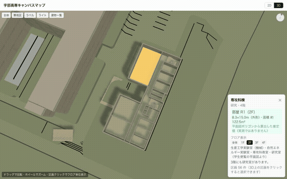
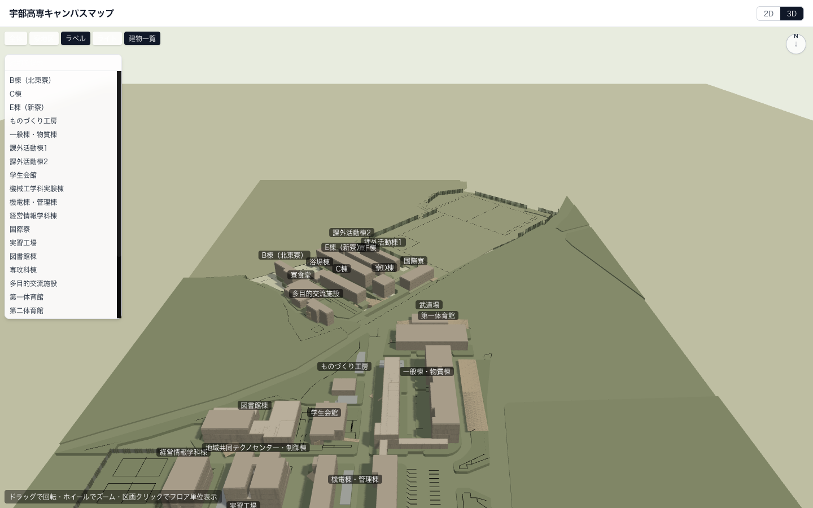
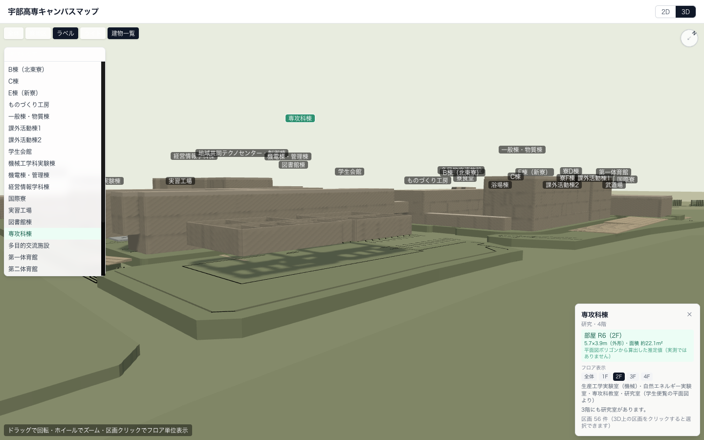
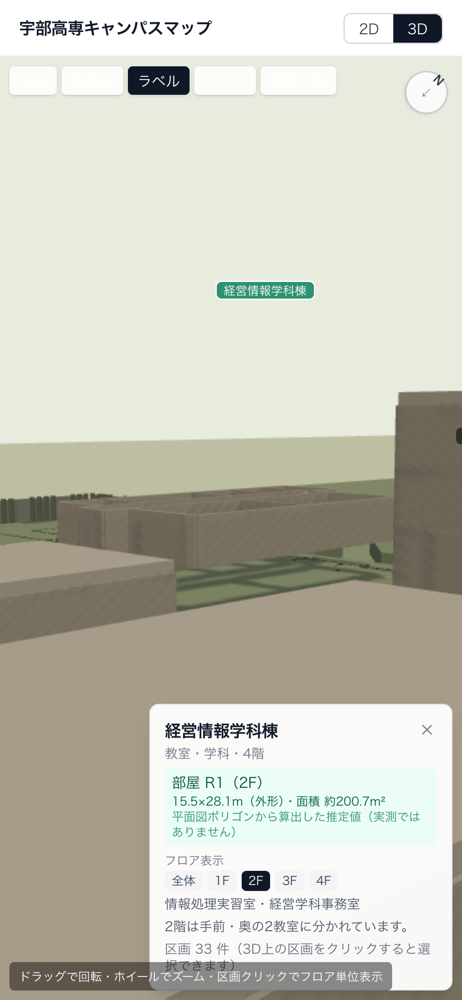
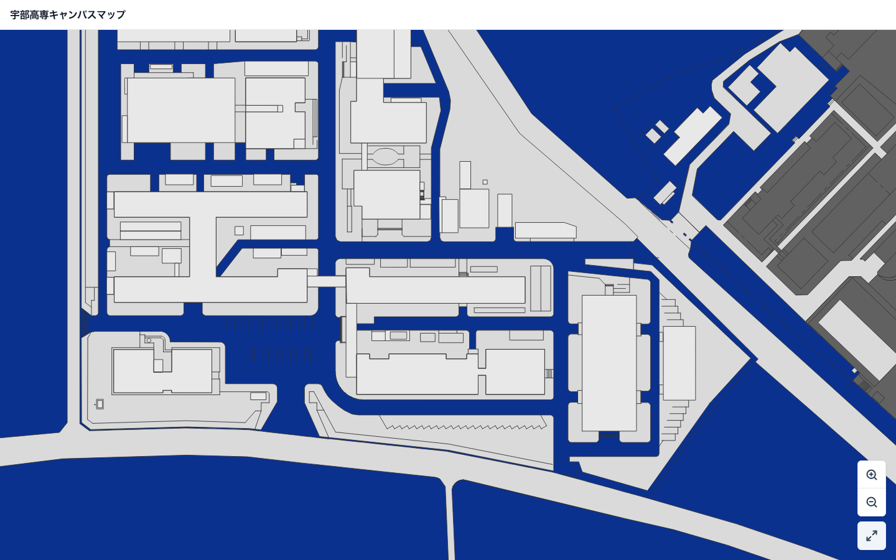

# 宇部高専キャンパスマップ

宇部高等専門学校の構内を、2Dマップと3Dキャンパスモデルの両方で確認できる
インタラクティブなキャンパスマップです。3Dビューでは建物が立体で浮かび、
フロアごとの部屋の形まで見られます。



_実際の画面収録。部屋選択から全体表示への復帰までの操作を確認できます。_

<details>
<summary>静止画: キャンパス全体の3D俯瞰</summary>



</details>

## 3Dキャンパスビューでできること

ヘッダーの **2D / 3D** トグルで切り替えます（初回は読み込みに数秒かかります）。



_専攻科棟2階の部屋を選択した画面。部屋の輪郭と推定寸法がパネルに表示されます。_

- **キャンパス全体の俯瞰**: 地形・建物・敷地の線画を立体で表示
- **建物の検索と選択**: 建物一覧から名前で探してフォーカス
- **フロアの選択と分離**: 建物を選ぶとフロア階層が表示され、チップで1フロアだけを取り出せます
- **部屋の選択**: フロア平面図の壁線画から抽出した実際の部屋ポリゴンをクリック / タップで選択
- **部屋の寸法表示**: 選択した部屋の外形と面積をパネルに表示
- **カメラ操作**: ドラッグで回転・移動、ホイール / ピンチでズーム、「全体」「寮地区」プリセット、ダークモード



_スマートフォンでも同じ操作ができます。_

部屋の寸法は平面図の縮尺から較正した**推定値**であり、実測値ではありません。
また、公開制限のある寮の内部は表示せず、外観のみを表示しています。

## 2Dマップでできること

2Dビューは構内図をそのまま表示する軽量なモードです。



- キャンパス全体図の表示とズーム / パン / フルスクリーン
- 建物をタップするとフロア階層を選択して表示
- トイレ・ごみ箱などの設備ポイント表示（密集時はクラスタ表示）

## 使い方

### 3Dビュー

- **ドラッグ**: 視点の回転・移動（タッチは1本指ドラッグ、ピンチでズーム）
- **ホイール / ピンチ**: ズーム
- **建物のクリック / タップ**: 建物情報パネルとフロア選択
- **フロアチップ**: その階だけを表示（「全体」で全階表示に戻る）
- **部屋のクリック / タップ**: 部屋を選択して寸法を表示
- **建物一覧**: ツールバーから開閉。選択すると自動で閉じます
- **全体 / 寮地区**: 視点プリセットへの移動

### 2Dビュー

- **ドラッグ / スワイプ**: 地図の移動
- **ホイール / ピンチ**: ズーム
- **建物のクリック / タップ**: フロア選択UIの表示
- **右上のボタン**: ズームイン・アウト、フルスクリーン切替

## 技術構成

- React 18 + TypeScript
- Vite 6
- Tailwind CSS 4
- Three.js（3Dレンダリング）
- Bun（パッケージマネージャ / ランタイムは mise で管理）

3Dモデルは `src/campus3d/` に分離されています。`geo/` が図面座標から
建物・部屋ポリゴン・地形を生成し（`roomPartition.ts` が壁線画から
部屋の閉領域を抽出）、`three/` が Three.js シーンを構築します。
2Dマップのデータ（`src/data/`）と描画実装（`src/components/map/`）も
分離しており、地図内容の更新はデータ側の変更で行えます。

## ローカルでの起動

```sh
mise install        # Bun などのツールチェーンをインストール
bun install         # 依存関係をインストール
bun run dev         # 開発サーバー起動
```

## 開発

```sh
bun run typecheck   # 型チェック
bun run lint        # ESLint
bun run format      # Prettier
bun run test        # ユニットテスト（Vitest）
bun run build       # 本番ビルド
```

部屋ポリゴンの検証レポートは `docs/evidence/room-report.json`、
ブラウザ実画面の証跡は `docs/evidence/shots/` にあります。
開発フロー・ガバナンスの詳細は `AGENTS.md` と `organization/` を参照してください。

## データの出典と注意事項

- 地図・平面図データは宇部高等専門学校が公開している構内図・学生便覧をもとに作成しています。
- 非公式のファンメイドツールであり、学校公式の見解を示すものではありません。
- 座標は模式図上の相対座標、部屋寸法は較正による推定値であり、いずれも実測値ではありません。
- 寮の内部は公開対象外のため、外観のみを表示しています。
- 収録アセットの詳細と公開方針は [docs/data-provenance.md](docs/data-provenance.md) を参照してください。

## ライセンス

コードは MIT License（[LICENSE](LICENSE)）で公開しています。
地図データには学校由来の素材を含むため、権利関係の詳細は
[docs/data-provenance.md](docs/data-provenance.md) を参照してください。
