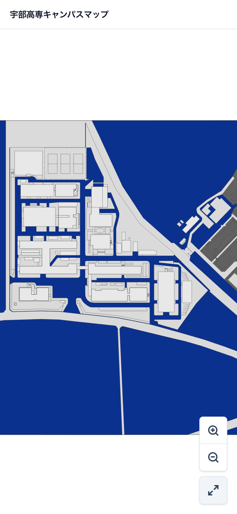

# 宇部高専キャンパスマップ

宇部高等専門学校の構内を、ズーム・パン・フロア表示で直感的に確認できる
インタラクティブなキャンパスマップです。




## 主な機能

- キャンパス全体図の表示（SVGベースのインタラクティブマップ）
- ズーム / パン / フルスクリーン表示
- 建物をタップすると、その建物のフロア階層を選択して表示
- トイレ・ごみ箱などの設備ポイント表示（クラスタリング対応）
- デスクトップ・モバイル両対応のタッチ操作

## 使い方

- **ドラッグ / スワイプ**: 地図の移動
- **ホイール / ピンチ**: ズーム
- **建物のクリック / タップ**: フロア選択UIの表示
- **右上のボタン**: ズームイン・アウト、フルスクリーン切替
- **`R` キー**: 回転モードの切替（上級者向け）

## 技術構成

- React 18 + TypeScript
- Vite 6
- Tailwind CSS 4
- Bun（パッケージマネージャ / ランタイムは mise で管理）

地図データ（`src/data/`）と描画実装（`src/components/map/`）は分離しており、
地図の内容更新はデータ側の変更で行えます。

## ローカルでの起動

```sh
mise install        # Bun などのツールチェーンをインストール
bun install         # 依存関係をインストール
bun run dev         # 開発サーバー起動
```

## 開発

```sh
bun run typecheck   # 型チェック
bun run lint        # ESLint
bun run format      # Prettier
bun run test        # ユニットテスト（Vitest）
bun run build       # 本番ビルド
```

開発フロー・ガバナンスの詳細は `AGENTS.md` と `organization/` を参照してください。

## データの出典と注意事項

- 地図データは宇部高等専門学校が公開している構内図をもとに作成しています。
- 非公式のファンメイドツールであり、学校公式の見解を示すものではありません。
- 座標は模式図上の相対座標であり、実測値ではありません。
- 収録アセットの詳細と公開方針は [docs/data-provenance.md](docs/data-provenance.md) を参照してください。

## ライセンス

コードおよび地図データのライセンスは現在検討中です。
学校由来の素材を含むため、権利関係が確定するまで再配布・二次利用はお控えください。
